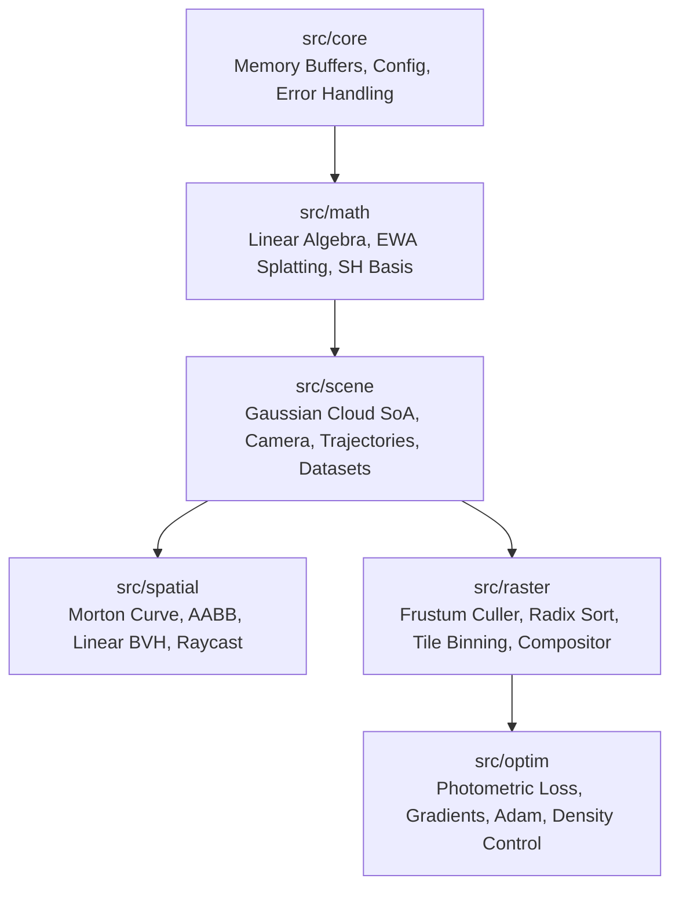
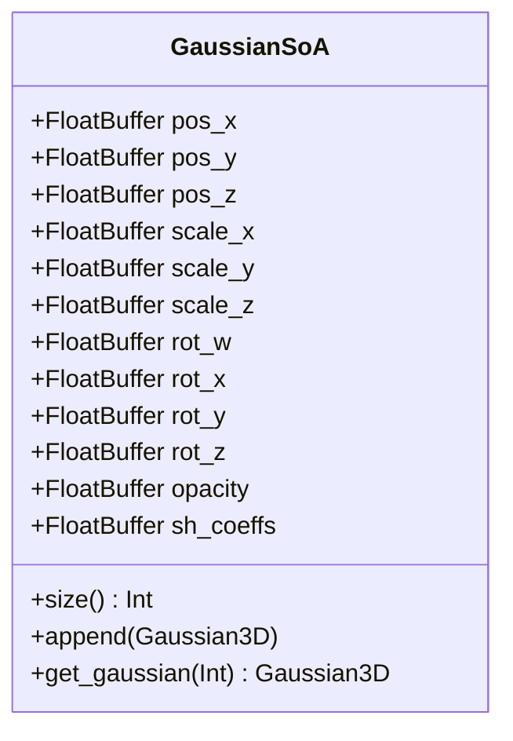
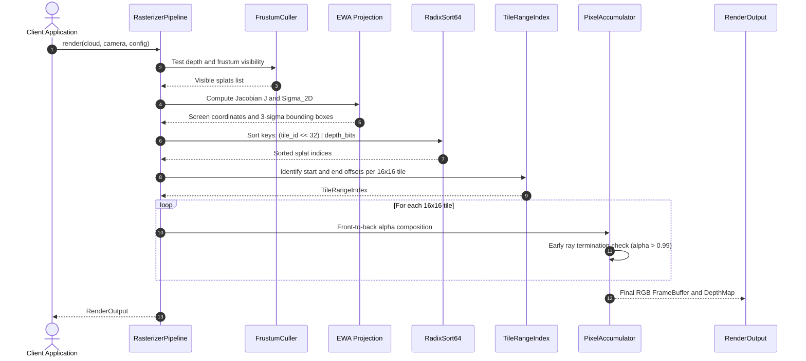

# Lumen Architecture Specification

Lumen is an ultra-high performance 3D Gaussian Splatting (3DGS) and radiance field rasterization engine engineered in Mojo with zero-overhead C and Python interfaces.

This document details the architectural layout, memory subsystem, execution stages, and data flow pipelines that power Lumen.

---

## 1. High-Level Subsystem Organization

Lumen is partitioned into six decoupled subsystems designed for mechanical sympathy, cache locality, and SIMD vectorization:

### Subsystem Directory Taxonomy

1. `src/core/`:
   - `types.mojo`: Compile-time precision aliases (`Float32`, `UInt32`, `UInt64`), spatial constants, and high-performance float parsing.
   - `buffer.mojo`: Cache-aligned contiguous heap dynamic arrays (`FloatBuffer`, `IntBuffer`, `UInt64Buffer`, `UInt32Buffer`).
   - `config.mojo`: Immutable execution descriptors for rasterization, camera optics, and optimization hyperparameters.
   - `error.mojo`: Strong error status types and propagation semantics.

2. `src/math/`:
   - `vector.mojo`: 2D, 3D, and 4D vector algebra with vector math operators, normalization, dot and cross products.
   - `matrix.mojo`: 2x2, 3x3, and 4x4 row-major matrices, determinants, transpositions, and projective transformations.
   - `quaternion.mojo`: Unit quaternions representing SO(3) spatial rotations, SLERP with collinear dot fallback, and matrix conversion.
   - `covariance.mojo`: 3D Gaussian spatial covariance synthesis: $\Sigma = R S S^T R^T$.
   - `projection.mojo`: Projective Jacobian computation ($J$) and Elliptical Weighted Average (EWA) 2D screen covariance splatting.
   - `spherical_harmonics.mojo`: 16 real spherical harmonics basis polynomials up to degree 3 for view-dependent color.
   - `cholesky.mojo`: 2D symmetric eigenvalue decomposition, 3-sigma radius derivation, and 3D Cholesky factorization.

3. `src/scene/`:
   - `gaussian.mojo`: Single Gaussian 3D primitive and Structure-of-Arrays (SoA) SIMD memory layout.
   - `gaussian_cloud.mojo`: High-capacity Gaussian cloud container with bounding box extraction and centroid updates.
   - `camera.mojo`: Pinhole camera model with look-at view matrix generation and pixel-to-ray projection.
   - `trajectory.mojo`: Catmull-Rom spline trajectory generation, 360-degree turntable orbits, and keyframe interpolation.
   - `ply.mojo`: High-speed Stanford PLY format reader and writer for spatial radiance checkpoints.
   - `datasets.mojo`: Synthetic scene generators and Structure-from-Motion (COLMAP) dataset ingestion.

4. `src/spatial/`:
   - `morton.mojo`: 30-bit Morton code spatial hashing and Z-order bitwise interleaving for spatial coherence.
   - `aabb.mojo`: 3D Axis-Aligned Bounding Box (AABB) with Kay-Kajiya slab method ray intersection.
   - `bvh.mojo`: Linear Bounding Volume Hierarchy (LBVH) construction from Morton codes.
   - `raycast.mojo`: Hierarchical ray-splat intersection testing and closest Gaussian picking.

5. `src/raster/`:
   - `culling.mojo`: View-frustum clipping, near-plane and far-plane rejection, and screen boundary validation.
   - `tile.mojo`: 16x16 screen tile subdivision, coordinate mapping, and tile grid indexing.
   - `radix_sort.mojo`: 64-bit Least Significant Digit (LSD) radix sort on composite tile and depth keys.
   - `binning.mojo`: Contiguous tile range indexing for fast thread execution without memory allocations.
   - `compositor.mojo`: Front-to-back alpha blending compositor with early ray termination ($\alpha > 0.99$).
   - `depth_map.mojo`: Continuous depth buffer rasterization and surface normal extraction via cross gradient.
   - `pipeline.mojo`: Complete end-to-end rendering pipeline coordinating culling, projection, sorting, and synthesis.

6. `src/optim/`:
   - `loss.mojo`: Photometric loss calculation combining L1 pixel error, SSIM window metric, and PSNR.
   - `gradients.mojo`: Gaussian parameter gradient accumulation and view-space positional gradient tracking.
   - `optimizer.mojo`: Adam optimizer with per-parameter group learning rate schedules.
   - `density_control.mojo`: Adaptive Density Control (ADC): cloning under-reconstructed splats, splitting large splats, pruning transparent splats, and periodic opacity resets.
   - `trainer.mojo`: Full offline training loop coordinating scene loss backpropagation and radiance field optimization.

---

## 2. Memory Subsystem & Structure of Arrays (SoA)

Rendering hundreds of thousands of 3D Gaussians in real time requires strict memory bandwidth optimization. Standard Array of Structures (AoS) models suffer from cache pollution during culling and projection, where only position and scale are needed.

Lumen implements dual representations:
1. `Gaussian3D`: Ergonomic Array of Structures (AoS) value type for single-splat manipulations and API boundaries.
2. `GaussianSoA`: Contiguous, cache-aligned Structure of Arrays (SoA) for vectorized batch execution.

During the culling stage, only `pos_x`, `pos_y`, and `pos_z` are loaded into cache lines, maximizing spatial and temporal locality.

---

## 3. End-to-End Rasterization Pipeline

---

## 4. Foreign Interface Bridges (C & Python)

To enable seamless embedding across diverse technical stacks, Lumen exposes dual native interfaces:

- **C ABI (`c_api/`)**: Clean C99/C11 shared library (`liblumen.dylib` / `liblumen.so`) with opaque handles, zero allocations in the render loop, and detailed telemetry statistics.
- **Python SDK (`python/`)**: High-level ergonomic package with trajectory spline generators, camera orbit controls, PLY readers/writers, and direct C ABI hardware acceleration.
- **Web Spatial Viewer (`web/`)**: Self-contained spatial computing viewer with real-time orbit camera, tile grid HUD, depth heatmaps, and streaming hooks.
