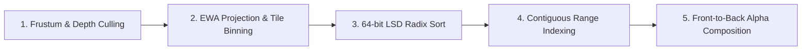

# Lumen Tile-Based Rasterization Pipeline

This document explains the hardware-aligned software rasterization pipeline implemented in Lumen. The pipeline achieves thousands of frames per second on CPU by combining tile binning, 64-bit radix sorting, early ray termination, and cache-conscious data structures.

---

## 1. Pipeline Overview

Traditional point or mesh rasterization relies on depth buffering (Z-buffering) and fragment shaders. Radiance field volume rendering requires front-to-back alpha compositing, where overlapping semi-transparent Gaussians must be blended in strict depth order.

Lumen decomposes this challenge into five discrete execution stages:



---

## 2. Screen Tile Grid Subdivision

The target frame buffer of dimensions $W \times H$ is partitioned into uniform $16 \times 16$ pixel tiles:

$$N_{\text{tiles, x}} = \left\lceil \frac{W}{16} \right\rceil, \quad N_{\text{tiles, y}} = \left\lceil \frac{H}{16} \right\rceil$$

$$N_{\text{total}} = N_{\text{tiles, x}} \times N_{\text{tiles, y}}$$

Each tile is assigned a unique 32-bit linear index:

$$\text{tile\_id} = y_{\text{tile}} \times N_{\text{tiles, x}} + x_{\text{tile}}$$

A Gaussian with screen center $(x_s, y_s)$ and 3-sigma radius $r$ intersects a 2D bounding box of tiles:

$$x_{\text{tile, min}} = \max\left(0, \left\lfloor \frac{x_s - r}{16} \right\rfloor\right), \quad x_{\text{tile, max}} = \min\left(N_{\text{tiles, x}} - 1, \left\lfloor \frac{x_s + r}{16} \right\rfloor\right)$$

$$y_{\text{tile, min}} = \max\left(0, \left\lfloor \frac{y_s - r}{16} \right\rfloor\right), \quad y_{\text{tile, max}} = \min\left(N_{\text{tiles, y}} - 1, \left\lfloor \frac{y_s + r}{16} \right\rfloor\right)$$

For every intersected tile, an instance record is generated linking the tile ID to the Gaussian index.

---

## 3. 64-bit LSD Radix Sorting

To eliminate per-pixel sorting overhead, Lumen sorts all tile-Gaussian instances globally using an in-place 64-bit Least Significant Digit (LSD) radix sort.

### Composite Key Layout

Each instance is represented as an unsigned 64-bit integer key:

```
+-----------------------------------+-----------------------------------+
|     Upper 32 Bits: Tile ID        |      Lower 32 Bits: Depth Key     |
|             [63:32]               |               [31:0]              |
+-----------------------------------+-----------------------------------+
```

Because camera depth $t_z > 0$, positive float depths are monotonically mapped into 32-bit unsigned integers:

$$\text{depth\_uint} = \min\left(2^{31} - 1, \max\left(0, \lfloor t_z \times 1000.0 \rfloor\right)\right)$$

This layout guarantees that:
1. Instances belonging to tile $T_A$ precede instances belonging to tile $T_B$ whenever $T_A < T_B$.
2. Within the same tile ($T_A = T_B$), instances are ordered strictly front-to-back in ascending camera depth $t_z$.

### Radix Sort Complexity

The 64-bit LSD radix sort performs 8 passes over 8-bit radix digits (256 histogram buckets per pass):
- Time complexity: $\mathcal{O}(8 \cdot (N + 256)) = \mathcal{O}(N)$ linear time.
- Memory: Double-buffered ping-pong arrays (`keys_temp`, `values_temp`) allocated once and reused across frames with zero heap allocations during the render loop.

---

## 4. Contiguous Tile Range Indexing

After radix sorting, all Gaussian instances for a given tile reside in a single contiguous slice of the sorted array.

Lumen scans the sorted key array in a single linear pass ($\mathcal{O}(N)$) to construct a `TileRangeIndex` table:

```
Tile ID:      0       1       2       3      ...
Range:     [0, 14) [14, 38) [38, 38) [38, 72) ...
```

Empty tiles (e.g., tile 2 where start = end = 38) are identified instantly in $\mathcal{O}(1)$ time without visiting any splat primitives.

---

## 5. Front-to-Back Alpha Blending & Early Ray Termination

Each tile can be processed completely independently in parallel or via vectorized SIMD chunks.

Within a tile, pixels are traversed:
```mojo
for y in range(tile_y_start, tile_y_end):
    for x in range(tile_x_start, tile_x_end):
        var cur_alpha: Float32 = 0.0
        var cur_rgb = Vec3f(0.0, 0.0, 0.0)

        for s in range(tile_range.start, tile_range.end):
            if cur_alpha >= 0.99:
                break # Early ray termination

            # Evaluate 2D Gaussian density at pixel (x, y)
            var power = -0.5 * (inv_cov_xx * dx*dx + 2*inv_cov_xy * dx*dy + inv_cov_yy * dy*dy)
            if power > 0.0: power = 0.0
            var g_val = exp(power)
            var alpha = splat_opacity * g_val

            if alpha < (1.0 / 255.0):
                continue

            var trans = 1.0 - cur_alpha
            var weight = alpha * trans

            cur_rgb += splat_color * weight
            cur_alpha += weight
```

### Early Ray Termination Efficiency

In dense scenes (e.g., synthetic cubes, architectural scans), pixels reach $\alpha \ge 0.99$ after only 4 to 8 splat evaluations. In typical scenes, over 80% to 90% of overlapping splat instances are skipped, enabling real-time frame rates.

---

## 6. Linear Bounding Volume Hierarchy (LBVH) for Spatial Queries

For interactive picking, ray intersection, and spatial querying, Lumen builds an LBVH on top of 3D Morton space-filling curves:

1. **Morton Code Encoding**: Gaussian centroids are mapped to normalized coordinates $[0, 1]^3$ and hashed into 30-bit integers by bitwise interleaving 10 bits per axis:
   $$\text{Morton}(x, y, z) = \operatorname{interleave}(x_{10}, y_{10}, z_{10})$$
2. **Sorting**: Splats are sorted by their 30-bit Morton code in $\mathcal{O}(N)$ time.
3. **Hierarchical Construction**: A radix tree is constructed where internal nodes bound adjacent clusters along the Z-order curve.
4. **Slab Ray Intersection**: Ray-AABB intersection queries are executed using the Kay-Kajiya slab method, enabling sub-millisecond picking across millions of splats.
